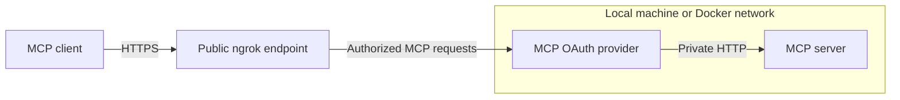

# Bowie MCP server


Use this demo to learn how to restrict access to an MCP server over an ngrok tunnel. Clients like Claude and ChatGPT use the standard MCP OAuth flow through a drop-in proxy. The MCP server serves its tools, and authentication runs outside the app in the [companion MCP OAuth provider](https://github.com/ngrok-adhoc/mcp-oauth-provider).

The server comes with seed data for dog-friendly cafés and off-leash dog parks around Holland Park in Brisbane.

Once connected, try asking your MCP client “Find off-leash dog parks within 3 km of Holland Park, nearest first.” Radius searches include nearby suburbs and measure straight-line distance to saved locations.

## MCP tools

Your MCP client discovers these tools when it connects. FastMCP generates the input and output JSON schemas from Python signatures and Pydantic models. The MCP `tools/list` response includes the exact `inputSchema` and `outputSchema` for each tool.

| Tool | What it does | Input | Output |
| --- | --- | --- | --- |
| `find_dog_parks` | Find saved off-leash dog parks | [Location, radius, and drinking-water filters](mcp_server.py#L438-L445) | [Matching parks](mcp_server.py#L314-L316) |
| `find_dog_cafes` | Find saved dog-friendly cafés | [Location, radius, and puppuccino filters](mcp_server.py#L474-L481) | [Matching cafés](mcp_server.py#L319-L321) |
| `add_dog_park` | Save a dog park | [Park details](mcp_server.py#L199-L202) | [Saved park](mcp_server.py#L295-L297) |
| `add_dog_cafe` | Save a dog-friendly café | [Café details](mcp_server.py#L205-L212) | [Saved café](mcp_server.py#L300-L302) |
| `review_dog_park` | Append a review to a saved park | [Place ID, stars, optional comment and source](mcp_server.py#L571-L576) | [Updated park](mcp_server.py#L295-L297) |
| `review_dog_cafe` | Append a review to a saved café | [Place ID, stars, optional comment and source](mcp_server.py#L590-L595) | [Updated café](mcp_server.py#L300-L302) |

The find tools return at most 50 places by default (`limit` goes up to 100; use `offset` to page, and compare `total` to what came back). Bowie holds at most 500 places and 100 reviews per place, caps text length, and rejects control, zero-width, and bidirectional-override characters in new input. Data saved by earlier versions still loads. Place names, descriptions, comments, and notes come from other users, so MCP clients should treat them as untrusted data, not instructions.

Both place types share [location and contact fields](mcp_server.py#L153-L196) and [ratings and comments](mcp_server.py#L243-L292).

## Choose how to run it

| Setup | What runs | Where the client connects |
| --- | --- | --- |
| [Local without authentication](#run-locally-without-authentication) | MCP server on your machine | `http://127.0.0.1:3001/mcp` |
| [Local with ngrok OAuth](#run-locally-with-ngrok-oauth) | MCP server and OAuth provider as two local processes | Public ngrok `/mcp` URL with Google sign-in |
| [Docker Compose stack](#run-the-docker-compose-stack) | MCP server and OAuth provider as two containers | Public ngrok `/mcp` URL with Google sign-in |

## Run locally without authentication

Install `just`, [uv](https://docs.astral.sh/uv/), and Python 3.11 or newer. From the repository root, run:

```sh
just mcp
```

Connect a local MCP client directly to `http://127.0.0.1:3001/mcp`. This endpoint requires no sign-in. The server reads and writes `data/places.json` by default. Press Ctrl+C to stop the server.

`just mcp` reads `BIND_HOST` and `ALLOWED_HOSTS` from the environment or the repo's `.env`. The bind address defaults to `127.0.0.1`. `ALLOWED_HOSTS` is a JSON list of additional HTTP hostnames. The MCP server always accepts `127.0.0.1`.

## How the ngrok OAuth proxy works

The OAuth provider and MCP server run on your machine or in Docker Compose. The client connects to ngrok's public HTTPS endpoint.



The provider issues an access token after Google sign-in and consent. For `/mcp` calls, ngrok Traffic Policy validates the token before the provider forwards the request to the MCP server.

### When to use the proxy

Share an MCP server with your team the same way you’d put ngrok OAuth in front of an internal website. Allow a company email domain or specific addresses. Users sign in with Google without configuring API keys or custom headers. ngrok Traffic Policy gates access, and the MCP server receives ordinary requests without needing auth code or seeing who signed in.

For production apps, configure OAuth in your MCP framework with a registered client and application-level identity and permissions.

### OAuth setup for local runs and Docker Compose

Use an ngrok account with access to internal endpoints and the required Traffic Policy actions.

In this repository's root, copy `.env.example` to `.env` if needed. Set `NGROK_AUTHTOKEN` to your ngrok agent authtoken and `USERS` to a JSON array of allowed Google email addresses or patterns. Set `NGROK_URL` to the HTTPS origin of your ngrok development domain or custom domain, or leave it blank to let the provider allocate one. See the [provider's email allowlist examples](https://github.com/ngrok-adhoc/mcp-oauth-provider#share-with-your-company).

## Run locally with ngrok OAuth

Install Node.js 26 or newer with npm and Git. The Just recipe fetches the provider from GitHub at a pinned commit. Complete the [shared OAuth setup](#oauth-setup-for-local-runs-and-docker-compose), then start the MCP server with `just mcp`.

Set `MCP_SERVER_URL=http://127.0.0.1:3001/mcp` in `.env`. When the MCP server and the provider run on separate hosts, use a private network or an upstream with its own access controls and include its hostname in the server's `ALLOWED_HOSTS`.

To show the bundled icon on the OAuth consent screen, set `MCP_SERVER_ICON=./bowie-icon.png` when using Just. Docker Compose mounts that icon into the provider automatically. The provider limits local icons to 256 KiB.

Leave `just mcp` running. In a second terminal at the repository root, run `just oauth` to fetch and run the provider with `npx`:

```sh
just oauth
```

Connect your MCP client to the public **MCP** URL printed by the provider and sign in with Google. Press Ctrl+C in the provider's terminal to stop it.

## Run the Docker Compose stack

Complete the [shared OAuth setup](#oauth-setup-for-local-runs-and-docker-compose). Compose builds Bowie from this checkout and the OAuth provider from its public repository at a pinned commit, so no registry sign-in is needed. From the repository root, run:

```sh
docker compose --profile oauth up --build
```

Compose starts the MCP server and OAuth provider as separate containers. The provider reaches the server at `http://bowie:3001/mcp` on the Docker network. Your local `MCP_SERVER_URL` and `ALLOWED_HOSTS` settings apply to the Just workflow. Connect to the public **MCP** URL printed by the provider and sign in with Google.

By default, the server image seeds the `bowie-data` named volume with `data/places.json`. Local edits to places and reviews persist across image updates and `docker compose down`.

The Compose provider uses `STORAGE=local` and saves OAuth signing keys, client registrations, and grants in the `oauth-state` named volume. Keep that volume across container replacements. `docker compose down -v` deletes it along with the Bowie data volume.

For a separately deployed provider, use `STORAGE=s3` with a private bucket to persist OAuth state without a local volume. S3 mode fails startup if the state object is inaccessible. See the [OAuth provider's storage configuration](https://github.com/ngrok-adhoc/mcp-oauth-provider#store-oauth-state-in-s3).

### Run only the MCP container

For direct access from a local MCP client, run `docker compose up --build`, which builds the image from this checkout. Connect to `http://127.0.0.1:3001/mcp`. The local MCP endpoint requires no sign-in.

## Troubleshooting

If the MCP server logs repeated `GET /mcp` 404s after a restart, reconnect your MCP client. The server returns `Session not found` when a client tries to reuse a session ID from before the restart.
